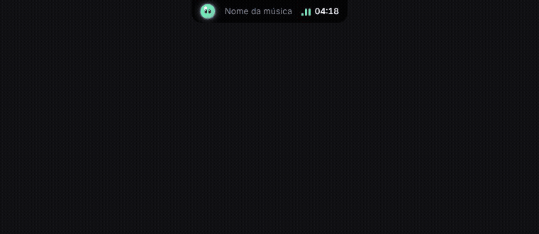

# Notchfy-Hard

Uma barra interativa que fica no topo da tela, para macOS, Windows e Linux.


Recolhida, ela é uma pílula com a hora e o que está tocando. Ao passar o mouse,
abre um painel com quatro abas:

| Aba | O que faz |
| --- | --- |
| **Início** | Música tocando agora (capa, progresso, tocar/pausar/avançar/voltar), relógio e calendário do mês |
| **Prateleira** | Solte arquivos na ilha para guardar; arraste de volta para qualquer app; clique para abrir |
| **Atalhos** | Apps favoritos, links, pastas e comandos, editáveis pela própria barra |
| **IA** | Tokens usados hoje e nos últimos 7 dias no Claude Code e no Codex CLI |

**Notificações na ilha (opcional, desligado por padrão):** ao ligar "Mostrar
notificações na ilha" no menu do ícone da bandeja, as notificações dos outros
apps descem na ilha e sobem de novo. Para elas aparecerem só na ilha, desligue
os avisos do sistema (no Windows, o modo Não incomodar). O app não guarda
nenhuma notificação.

No MacBook com notch, a pílula se encaixa em volta do recorte: a capa do
álbum fica à esquerda, a hora à direita e o centro fica sob o notch. Nas outras
telas ela é uma pílula preta presa ao topo.

## Como rodar

Pré-requisitos: [Node.js](https://nodejs.org) 20+, [Rust](https://rustup.rs) 1.82+
e as [dependências do Tauri](https://v2.tauri.app/start/prerequisites/) do seu sistema.

```bash
npm install
npm run tauri dev      # desenvolvimento, com recarga do frontend
npm run tauri build    # instalador em src-tauri/target/release/bundle/
```

O app não aparece no Dock nem na barra de tarefas. Para sair, use o ícone na
bandeja do sistema (barra de menus no Mac) → **Sair**.

Cada push roda o workflow `build` no GitHub Actions, que compila e testa nos três
sistemas e anexa os instaladores (`.dmg`, `.msi`/`.exe`, `.deb`/`.AppImage`) à execução.

## Limitações conhecidas

- **Música no macOS**: só Spotify e Música (app da Apple), via AppleScript. A
  API que cobria qualquer player (MediaRemote) foi fechada para apps de
  terceiros no macOS 15.4. Na primeira vez o macOS pede permissão de Automação.
  O app Música não fornece a capa do álbum por essa via.
- **Música no Linux**: qualquer player com MPRIS (Spotify, Firefox, Chrome, VLC…).
- **Música no Windows**: qualquer app que apareça no painel de mídia do sistema.
- **Linux com Wayland**: o Wayland não deixa um app escolher a posição da própria
  janela, e o GNOME não suporta o protocolo que permitiria isso
  (`wlr-layer-shell`). Por isso o Notchfy roda pelo XWayland (`GDK_BACKEND=x11`).
  Para testar outro backend, defina `GDK_BACKEND` antes de abrir.
- **Tokens de IA**: lidos dos logs locais (`~/.claude/projects` e
  `~/.codex/sessions`, ou `CLAUDE_CONFIG_DIR`/`CODEX_HOME`). O uso feito pelo
  navegador (claude.ai, chatgpt.com) não fica nesses arquivos e não aparece. Os
  valores são tokens, não custo; o total inclui leituras de cache, que costumam
  ser a maior parte.
- **Calendário**: mostra o mês, ainda sem eventos da sua agenda.
- **Notificações na ilha**: no Linux, lidas pelo D-Bus (testado). No Windows,
  pela API oficial, que segundo a documentação exige o app empacotado (MSIX,
  como na Microsoft Store); com o instalador `.exe` o Windows pode recusar, e a
  ilha mostra o código do erro. No macOS ainda não existe.
- **Assinatura**: os builds não são assinados. No macOS, abra com clique direito →
  Abrir (ou `xattr -dr com.apple.quarantine /Applications/Notchfy.app`); no
  Windows, o SmartScreen pede confirmação.

## Estrutura

```
src/                 Interface (TypeScript, sem framework)
  main.ts            Expandir/recolher, abas, arrastar arquivos para a ilha
  media.ts           Player
  shelf.ts           Prateleira e arraste para fora
  shortcuts.ts       Atalhos
  ai.ts              Painel de tokens
  clock.ts           Relógio e calendário
src-tauri/src/       Backend (Rust)
  lib.rs             Janela, posicionamento, comandos, bandeja
  platform.rs        Detecção do notch e nível da janela no macOS
  media.rs           Player por sistema (MPRIS, SMTC, AppleScript)
  tokens.rs          Leitura dos logs do Claude Code e do Codex
  store.rs           Atalhos e prateleira salvos em JSON
```

Os dados ficam em `notchfy.json`, na pasta de configuração do app
(`~/Library/Application Support/app.notchfy.hard`, `%APPDATA%\app.notchfy.hard`
ou `~/.config/app.notchfy.hard`).

## Contribuindo

As regras de código (para pessoas e IAs) estão em [AGENTS.md](AGENTS.md).

```bash
npm run check     # tipos, build, formatação, clippy sem avisos e testes
cd src-tauri && cargo test -- --ignored --nocapture print_local_report   # seu uso real de tokens
```

Para checar o código de outro sistema sem estar nele:

```bash
rustup target add x86_64-pc-windows-msvc aarch64-apple-darwin
cd src-tauri
cargo clippy --target x86_64-pc-windows-msvc --all-targets -- -D warnings
# macOS precisa do clang: um trecho em Objective-C é compilado
CC_aarch64_apple_darwin=clang CFLAGS_aarch64_apple_darwin="--target=arm64-apple-macos11" \
  cargo clippy --target aarch64-apple-darwin --all-targets -- -D warnings
```
